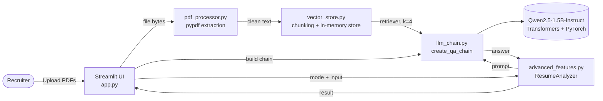
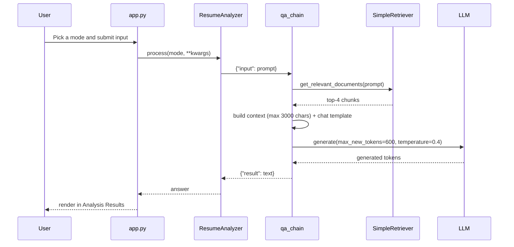

# TalentAI: AI Resume Screening Assistant


TalentAI is a **fully local** resume screening tool. Recruiters upload a batch of PDF resumes, and the app lets them ask natural-language questions, score candidates against a job description, extract structured profiles, and generate portfolio content as JSON. Everything runs on your own machine: no OpenAI key, no vector-database account, and no resume data sent to a third-party API.

---

## Table of Contents

1. [Features](#features)
2. [Architecture](#architecture)
3. [Tech Stack](#tech-stack)
4. [Project Structure](#project-structure)
5. [Getting Started](#getting-started)
6. [Usage](#usage)
7. [Configuration](#configuration)
8. [How It Works](#how-it-works)
9. [Known Limitations](#known-limitations)
10. [Roadmap](#roadmap)
11. [Troubleshooting](#troubleshooting)
12. [Privacy and Responsible Use](#privacy-and-responsible-use)
13. [Contributing](#contributing)
14. [License](#license)

---

## Features

| Feature | Description |
|---|---|
| **Batch PDF upload** | Upload multiple resumes at once; text is extracted and cleaned automatically. |
| **Standard Q&A** | Ask free-form questions such as *"Who has experience with React?"* and get a written answer grounded in resume content. |
| **Job Fit Scoring** | Paste a job description and receive a score out of 100 with a short justification. |
| **Profile Extraction** | Pull out key skills, total years of experience, and highest education level. |
| **Portfolio UI Generation** | Produce a structured JSON payload (Hero, QuickInfo, AboutMe, Skills, Projects, Experience, Education, and more) that can populate a portfolio template. |
| **Local LLM inference** | Uses `Qwen/Qwen2.5-1.5B-Instruct` via HuggingFace Transformers, on CPU or GPU. |
| **Session chat history** | Results accumulate during a session and can be cleared with one click. |
| **Branded landing page** | A custom HTML/CSS landing section is rendered above the interactive tool. |

---

## Architecture

TalentAI follows a simple retrieval-augmented generation (RAG) pipeline, split into small single-purpose modules.

### High-level system view



### Request lifecycle (one question)



### Component responsibilities

| Module | Responsibility |
|---|---|
| `app.py` | Streamlit entry point. Manages session state, renders the landing page and upload UI, wires the pipeline together, and displays results. |
| `src/pdf_processor.py` | Reads an uploaded PDF with `pypdf`, concatenates page text, and normalizes whitespace. Raises a descriptive error naming the failing file. |
| `src/vector_store.py` | Splits resume text into overlapping chunks (`RecursiveCharacterTextSplitter`) and stores them in memory with `filename` and `chunk_id` metadata. Exposes `SimpleRetriever`. |
| `src/llm_chain.py` | Loads the tokenizer and model, picks CPU or CUDA, builds the prompt via the model's chat template, runs generation, and returns `{"result": ...}`. Falls back to a seq2seq model class if the checkpoint is not a causal LM. |
| `src/advanced_features.py` | `ResumeAnalyzer` is a thin controller that maps each analysis mode to a task-specific prompt and delegates to the QA chain. New modes can be added without touching the core chain. |
| `src/ui_template.py` | Generates the landing-page HTML/CSS. Embeds images as base64 and falls back to placeholder blocks if image files are missing. |
| `src/UI/` | Prototype dashboard components (metrics, charts, sidebar). See [Known Limitations](#known-limitations). |

### Key design decisions

- **Local-first.** Inference and retrieval both run in-process, so candidate data never leaves the machine.
- **Small instruct model.** A 1.5B-parameter model keeps the app usable on laptops without a GPU, at the cost of answer depth.
- **Chain as a closure.** `create_qa_chain` returns a plain callable (`{"input": str} -> {"result": str}`), which keeps the analyzer decoupled from the model implementation. Swapping in a different LLM only requires changing this one function.
- **Analyzer layer.** Every analysis mode is just a prompt template over the same retrieval and generation path, so adding a mode is a small, isolated change.
- **Grounded prompting.** The user prompt instructs the model to answer *based only on* the retrieved context, and the chain short-circuits with "No relevant information found." when retrieval returns nothing.

---

## Tech Stack

| Layer | Technology |
|---|---|
| Frontend | Streamlit, custom HTML/CSS landing page |
| LLM runtime | HuggingFace Transformers, PyTorch, Accelerate |
| Default model | `Qwen/Qwen2.5-1.5B-Instruct` |
| PDF parsing | pypdf |
| Text splitting | `langchain-text-splitters` (`RecursiveCharacterTextSplitter`) |
| Retrieval | Custom in-memory keyword-overlap retriever |
| Config | `python-dotenv`, `.streamlit/config.toml` |
| Packaging | `requirements.txt`, `pyproject.toml` + `uv.lock` |

---

## Project Structure

```text
chatbot/
├── app.py                    # Streamlit entry point
├── requirements.txt          # pip dependencies
├── pyproject.toml            # project metadata and dependencies (uv)
├── uv.lock                   # locked dependency versions
├── .env.example              # environment variable template
├── .streamlit/
│   └── config.toml           # theme, port, logging
└── src/
    ├── pdf_processor.py      # PDF text extraction
    ├── vector_store.py       # chunking, storage, retrieval
    ├── llm_chain.py          # model loading and generation
    ├── advanced_features.py  # ResumeAnalyzer (analysis modes)
    ├── ui_template.py        # landing page HTML/CSS
    └── UI/                   # prototype dashboard components
        ├── analytics.py
        ├── cards.py
        ├── dashboard.py
        ├── sidebar.py
        └── style.css
```

> The repository also contains a Next.js / shadcn-ui scaffold (`app/`, `components/`, `hooks/`, `lib/`, `public/`, `styles/`, `package.json`, and related config). It was generated by v0 and is **not used** by the Streamlit application.

---

## Getting Started

### Prerequisites

- Python **3.11 or newer**
- `pip` or [`uv`](https://docs.astral.sh/uv/)
- Roughly 3 GB of free disk space for the model download, and about 6 GB of RAM for CPU inference (the model loads in float32 on CPU)
- Optional: a CUDA-capable GPU for much faster generation (the app switches to float16 automatically)

### Installation

```bash
# 1. Clone the repository
git clone <repository-url>
cd chatbot

# 2. Create and activate a virtual environment
python -m venv .venv
source .venv/bin/activate          # Windows: .venv\Scripts\activate

# 3. Install dependencies
pip install -r requirements.txt
```

Using `uv` instead:

```bash
uv sync
```

### Run the app

```bash
streamlit run app.py
```

or, with `uv`:

```bash
uv run streamlit run app.py
```

Open **http://localhost:8501** in your browser.

> **First run:** the model weights are downloaded from the HuggingFace Hub the first time you click **Process Resumes**, so the first run takes noticeably longer. Later runs use the local cache.

### Environment variables

No API keys are required. `.env.example` is provided as a template if you add configuration later.

---

## Usage

1. **Upload** one or more PDF resumes using the file uploader.
2. Click **Process Resumes**. The app extracts text, chunks it, builds the in-memory index, and loads the model.
3. Choose an **Analysis Mode**:

| Mode | What to do | Example |
|---|---|---|
| **Standard Q&A** | Type a question and click *Ask AI* | "Which candidate has leadership experience?" |
| **Job Fit Scoring** | Paste a job description and click *Calculate Fit Score* | A backend engineer JD requiring Python and AWS |
| **Profile Extraction** | Click *Extract Profiles* | Returns skills, years of experience, education |
| **Portfolio UI Generation** | Click *Generate UI JSON* | Returns section-mapped JSON for a portfolio template |

4. Results appear under **Analysis Results**, newest first. Use **Clear History** to reset.

---

## Configuration

Most tunables live in the source files and can be changed directly.

| Setting | Location | Default | Effect |
|---|---|---|---|
| Model | `selected_model` in `app.py` | `Qwen/Qwen2.5-1.5B-Instruct` | Any HuggingFace instruct model; causal LMs preferred, seq2seq supported as a fallback. |
| Chunk size | `RecursiveCharacterTextSplitter` in `vector_store.py` | `500` characters | Smaller chunks give more precise retrieval; larger chunks give more context per hit. |
| Chunk overlap | same | `50` characters | Reduces information loss at chunk boundaries. |
| Retrieved chunks (`k`) | `get_retriever(k=4)` in `llm_chain.py` | `4` | More chunks add context but slow generation. |
| Context cap | `context[:3000]` in `llm_chain.py` | `3000` characters | Guards against prompt overflow on small models. |
| Max new tokens | `model.generate(...)` in `llm_chain.py` | `600` | Upper bound on answer length. |
| Temperature | same | `0.4` | Lower is more deterministic; sampling is enabled. |
| Server port | `.streamlit/config.toml` | `8501` | Port Streamlit listens on. |
| Theme | `.streamlit/config.toml` | Blue primary on white | Streamlit theme colors. |

---

## How It Works

### 1. Ingestion

`process_pdf()` reads each uploaded file into a `PdfReader`, extracts text page by page, joins it, and collapses all whitespace into single spaces. Corrupt or unreadable files raise an error that names the file.

### 2. Chunking and indexing

`VectorStore.add_documents()` splits each resume into ~500-character chunks with 50 characters of overlap. Each chunk is stored with its source filename and chunk index so results can be traced back to a candidate.

### 3. Retrieval

`SimpleRetriever` scores every chunk by keyword overlap with the query:

```text
score(chunk) = |query_words ∩ chunk_words| / |query_words|
```

Words are lowercased and split on whitespace. The top `k` chunks are returned as LangChain `Document` objects.

### 4. Prompt construction

Retrieved chunks are joined and truncated to 3000 characters. The chain then builds a two-message prompt:

- **System:** the model acts as an expert HR recruiter and responds in clear, professional prose.
- **User:** "Based ONLY on the following context..." followed by the context and the question.

The model's own chat template is applied when available, with a plain-text fallback.

### 5. Generation

The model generates up to 600 new tokens with sampling (`temperature=0.4`). Only the newly generated tokens are decoded and returned.

### 6. Analysis modes

`ResumeAnalyzer.process(mode, **kwargs)` routes to one of four handlers (`qa`, `job_fit`, `extract_profile`, `portfolio_ui`). Each handler wraps the request in a task-specific prompt and calls the same QA chain.

---

## Known Limitations

Being upfront about the current scope:

- **Retrieval is lexical, not semantic.** Matching is exact-word overlap with no stemming, stop-word removal, or embeddings, so synonyms ("ML" vs "machine learning") are missed and common words can skew scores.
- **Corpus-level answers.** Retrieval runs across all uploaded resumes together and returns only the top 4 chunks. Job Fit and Profile Extraction therefore summarize whichever chunks match the prompt, rather than scoring each candidate separately.
- **Small-model quality.** A 1.5B model can miss details, produce inconsistent scores, or return malformed JSON. Treat output as a first-pass aid, not a verdict.
- **Non-deterministic output.** Sampling is on, so repeated runs can differ.
- **No persistence.** The index and history live in Streamlit session state and are lost when the session ends.
- **Model reloads on every processing run.** The model is not cached across runs, which adds startup time.
- **Text-based PDFs only.** Scanned or image-only resumes have no extractable text layer and are not OCR'd.
- **Landing-page images use local absolute paths** defined in `app.py`. On other machines the app falls back to placeholder blocks. Moving the images into an `assets/` folder and using relative paths fixes this.
- **Dashboard prototype is not wired in.** `src/UI/` uses hard-coded sample data, is not called from `app.py`, and needs `pandas` and `plotly`, which are not listed in `requirements.txt`.
- **No automated tests yet.**

---

## Roadmap

- [ ] Replace keyword retrieval with embeddings (e.g. `sentence-transformers`) and a vector index (FAISS or Chroma)
- [ ] Per-candidate scoring and a ranked comparison table
- [ ] Cache the model with `st.cache_resource` to avoid reloading
- [ ] Validate and repair structured JSON output (schema-based parsing)
- [ ] OCR fallback for scanned PDFs
- [ ] Model selector in the UI and optional hosted-LLM backend
- [ ] Persistent storage for processed resumes
- [ ] Export results to CSV / PDF
- [ ] Unit tests for the PDF, chunking, and retrieval modules, plus CI
- [ ] Wire up or remove the `src/UI/` dashboard prototype and the unused Next.js scaffold

---

## Troubleshooting

| Problem | Likely cause and fix |
|---|---|
| `Error processing PDF <name>` | The file is corrupt, encrypted, or image-only. Try another file or run OCR first. |
| First run hangs on "Setting up AI..." | The model is downloading. Check your connection and allow a few minutes. |
| Very slow answers | CPU inference with a 1.5B model is slow. Use a GPU, lower `max_new_tokens`, lower `k`, or choose a smaller model. |
| Out-of-memory errors | Close other applications, choose a smaller model, or use a machine with more RAM / VRAM. |
| "No relevant information found." | No chunk shared any words with the query. Rephrase using terms that appear in the resumes. |
| Port already in use | Change `port` in `.streamlit/config.toml` or run `streamlit run app.py --server.port 8502`. |
| Placeholder boxes instead of landing-page images | Image paths in `app.py` point to files that do not exist on your machine. |

---

## Privacy and Responsible Use

- **Local processing.** Resume text and model inference stay on your machine. The only network calls are the one-time model download from the HuggingFace Hub and the web fonts loaded by the landing page.
- **Personal data.** Resumes contain sensitive personal information. Handle uploads according to your local data-protection requirements and avoid sharing the running app on an open network without authentication.
- **Human in the loop.** Automated scores and summaries can be wrong or biased. Use TalentAI to assist screening, never as the sole basis for hiring decisions.

---

## Contributing

Contributions are welcome.

1. Fork the repository and create a feature branch: `git checkout -b feature/your-feature`
2. Make your changes with clear, focused commits
3. Open a pull request describing what changed and why

Please open an issue first for larger changes so the approach can be discussed.

---

## License

Distributed under the MIT License. See the `LICENSE` file for details.
